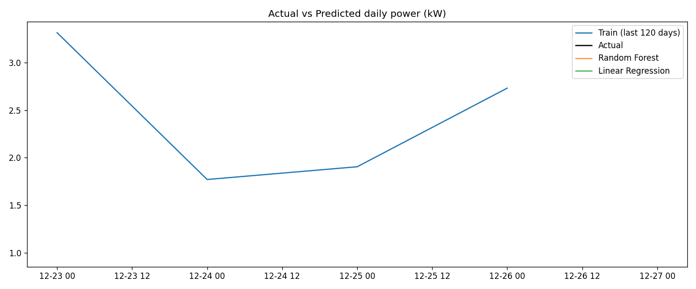

# Predictive Analytics Using Historical Data

Forecasting daily household electricity consumption from historical data using regression models.

## Objective
Build a predictive model that learns from past electricity usage and forecasts future values, then evaluate its accuracy and visualize the predictions.

## Dataset
**Household Electric Power Consumption** (UCI Machine Learning Repository, via Kaggle)
- About 2 million minute-level measurements, December 2006 to November 2010
- Target variable: `Global_active_power` (kW)
- About 1.25% of rows have missing values (marked `?`)

## Approach
1. **Load and clean:** treat `?` as missing, aggregate minute data into daily averages, interpolate missing days.
2. **Feature engineering:** yesterday's value (`lag_1`), value one week ago (`lag_7`), 7-day rolling average, day of week, month. Only past information is used, so there is no data leakage.
3. **Time-ordered split:** first 80% of days for training, last 20% for testing (no shuffling).
4. **Models compared:** Naive baseline (same as yesterday), Linear Regression, Random Forest.
5. **Evaluation:** MAE, RMSE, R2 and MAPE on the test set.

## Results
<!-- Replace with the numbers printed when you ran the script -->
| Model | MAE | RMSE | R2 | MAPE % |
|---|---|---|---|---|
| Naive (yesterday) | | | | |
| Linear Regression | | | | |
| Random Forest | | | | |

**Conclusion:** <!-- one or two sentences: which model won and why -->



## How to run
```bash
pip install pandas numpy scikit-learn matplotlib
python power_forecast.py household_power_consumption.txt
```
Download the dataset from Kaggle: search "Household Electric Power Consumption" (uciml). It is not included in this repo because of its size.

## Files
- `power_forecast.py`: full pipeline (cleaning, features, models, evaluation, plots)
- `power_results.csv`: metrics table
- `trend.png`: historical trend of daily power
- `power_actual_vs_predicted.png`: actual vs predicted on the test set
